I'm very fortunate to work with several amazing students to whom I serve as their primary advisor or co-advisor.

## Current Members

<!-- Principal Investigator -->

  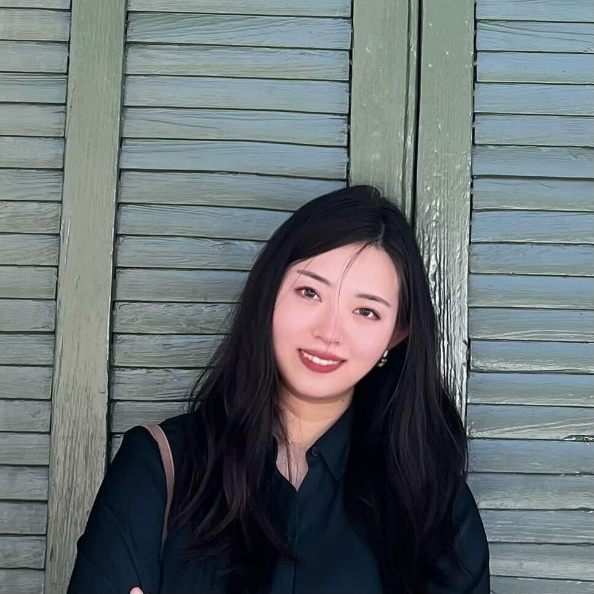
  

    
<strong>Ying Ma</strong> 
    Edens Family Assistant Professor of Healthcare Communications &amp; Technology; Assistant Professor of Biostatistics &amp; CCMB, Brown University (2023 – Present)

  

<!-- PhD Candidates -->

  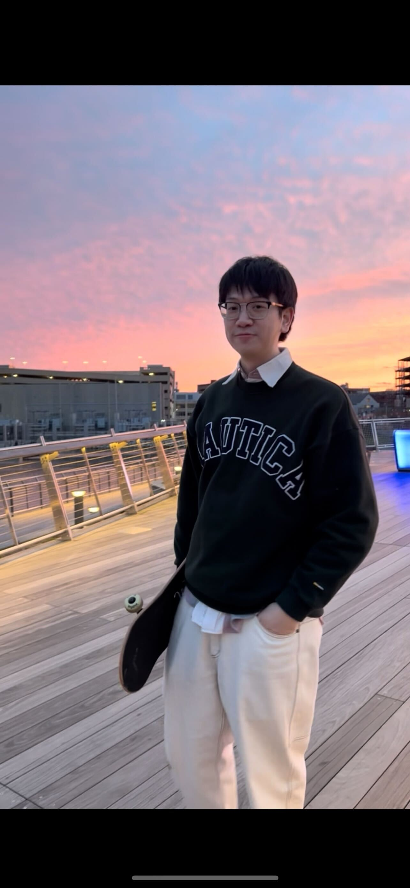
  

    
<strong>Chichun (TJ) Tan</strong> 
    PhD Candidate, Biostatistics, Brown University (08/2023 – Present)

  

  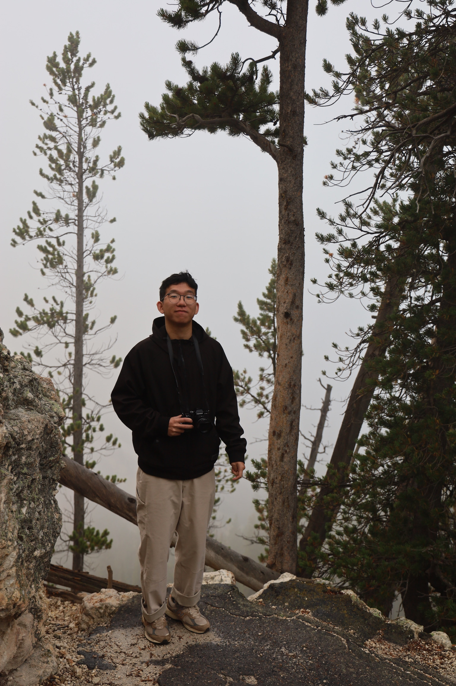
  

    
<strong>Xin Wei</strong> 
    PhD Candidate, Biostatistics, Brown University (08/2023 – Present), co-advised with Prof. Zhijin (Jean) Wu

  

  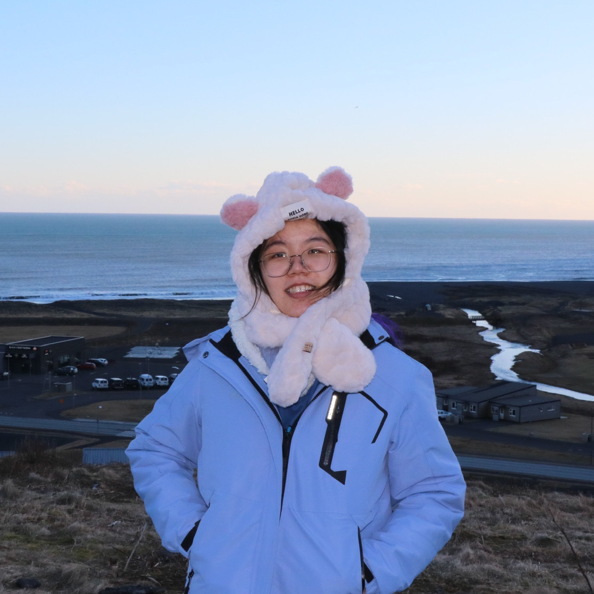
  

    
<strong>Yu (Zoe) Zhu</strong> 
    PhD Candidate, Computational Biology, Brown University (02/2024 – Present)

  

  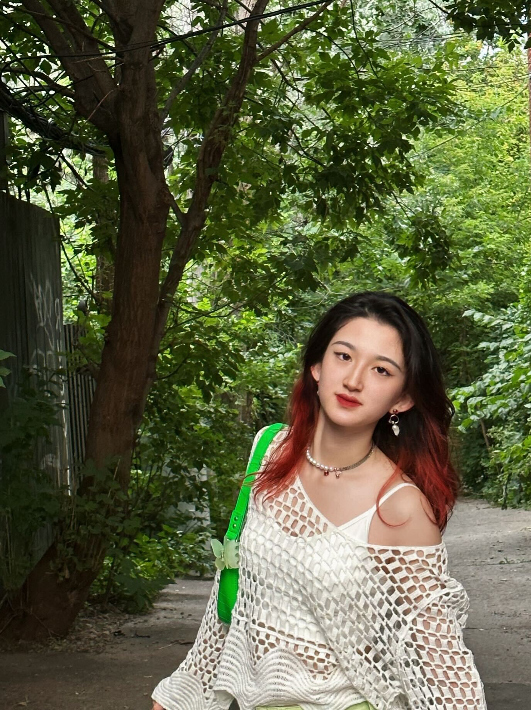
  

    
<strong>Ruohan Wang</strong> 
    PhD Candidate, Computational Biology, Brown University (09/2024 – Present)

  

<!-- PhD Students -->

  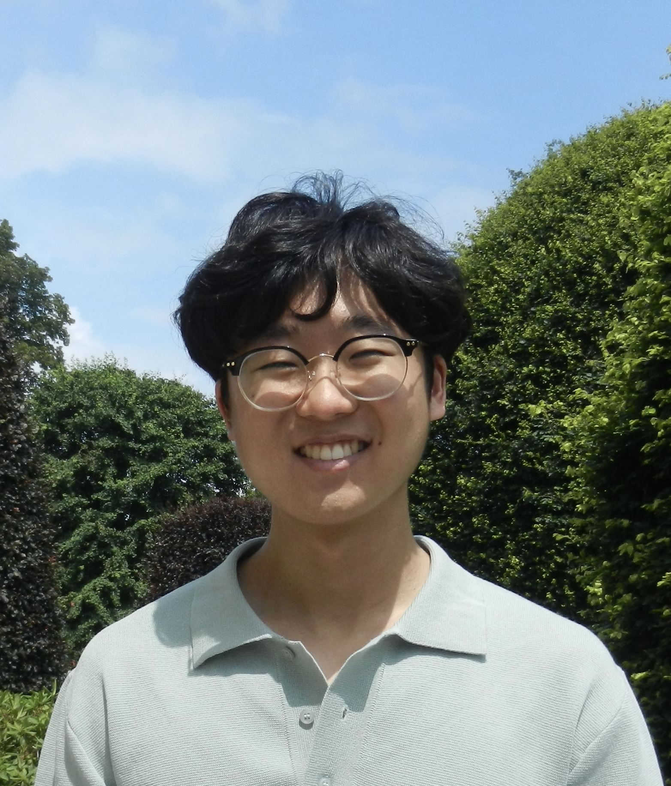
  

    
<strong>Seowon Chang</strong> 
    PhD Student, Computational Biology, Brown University (09/2025 – Present) 
    Previously an undergraduate researcher in the Ma Lab (2023–2025)

  

  
  

    
<strong>Jing Fu</strong> 
    PhD Student, Biostatistics, Brown University (09/2025 – Present), co-advised with Prof. Christopher Schmid 
    Previously a master's student in the Ma Lab (2023–2025)

  

  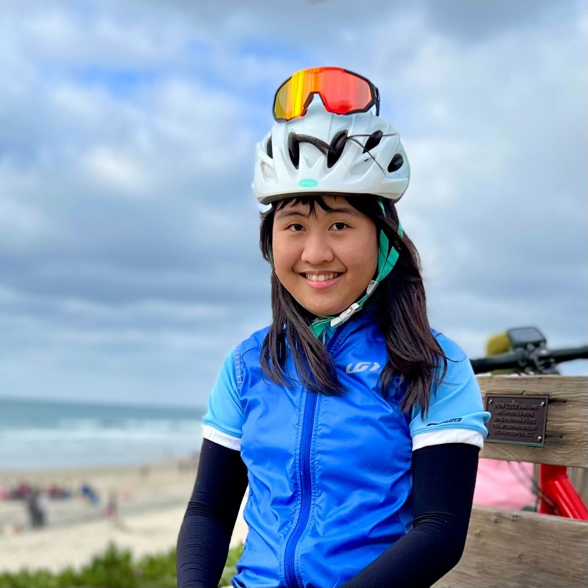
  

    
<strong>Man-Fang Liang</strong> 
    PhD Student, Statistics, Purdue University (2026 – Present), co-advised with Dr. Gao (primary advisor) 
    Previously a master's student in the Ma Lab (2025–2026)

  

<!-- MD Student -->

  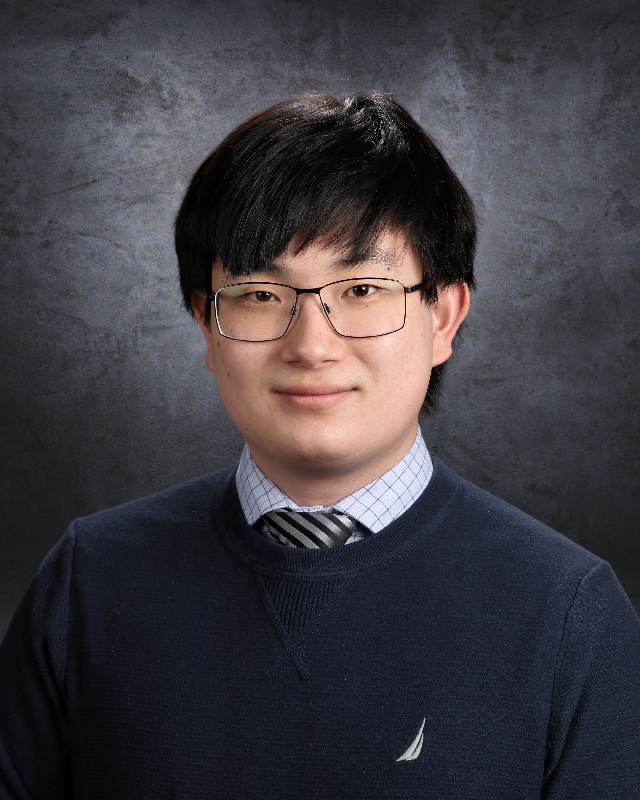
  

    
<strong>Andrew Yang</strong> 
    MD Student, Warren Alpert Medical School, Brown University (09/2025 – Present) 
    Previously an undergraduate researcher in the Ma Lab (2023–2025)

  

<!-- PhD Rotation Student -->

  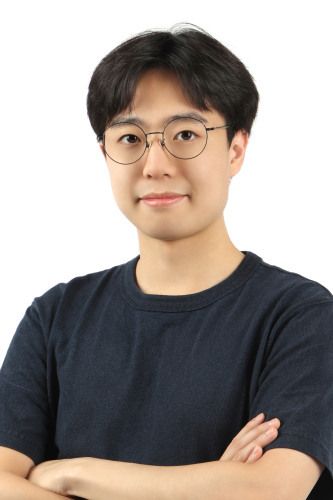
  

    
<strong>Junbong Jang</strong> 
    PhD Rotation Student, Computational Biology, Brown University (2026 – Present)

  

<!-- Master's Students -->

  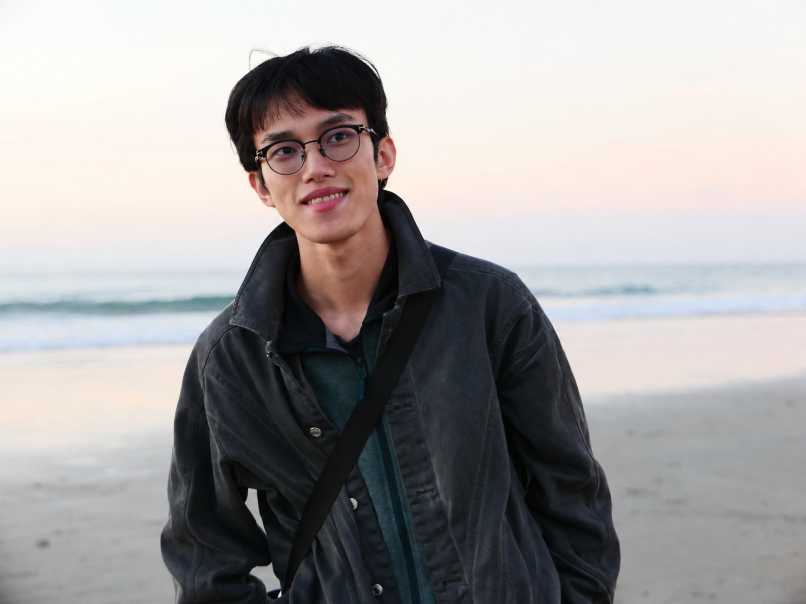
  

    
<strong>Zhongyu Fan</strong> 
    Master's Student, Biostatistics, Brown University (2025 – Present)

  

  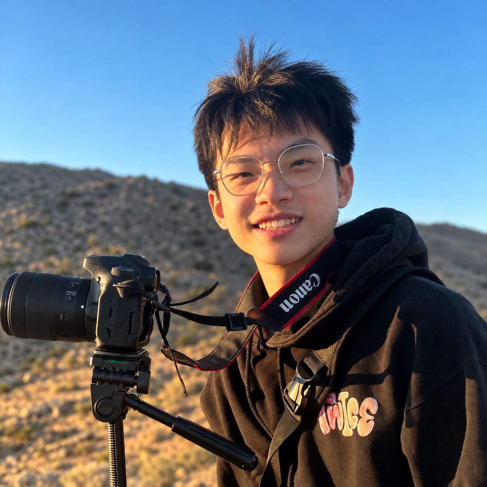
  

    
<strong>Haochen Tan</strong> 
    Master's Student, Biostatistics, Brown University (2025 – Present)

  

  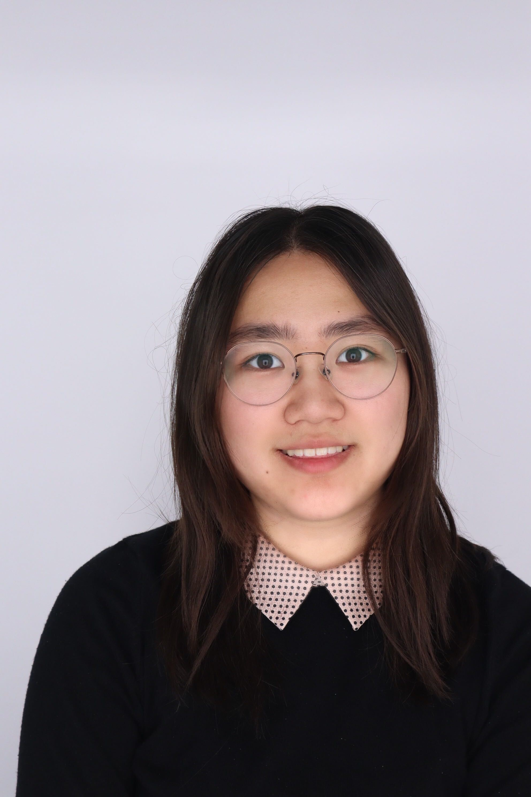
  

    
<strong>Chaewon Oh</strong> 
    Master's Student, Biostatistics, Brown University (2026 – Present)

  

<!-- Undergraduate Student -->

  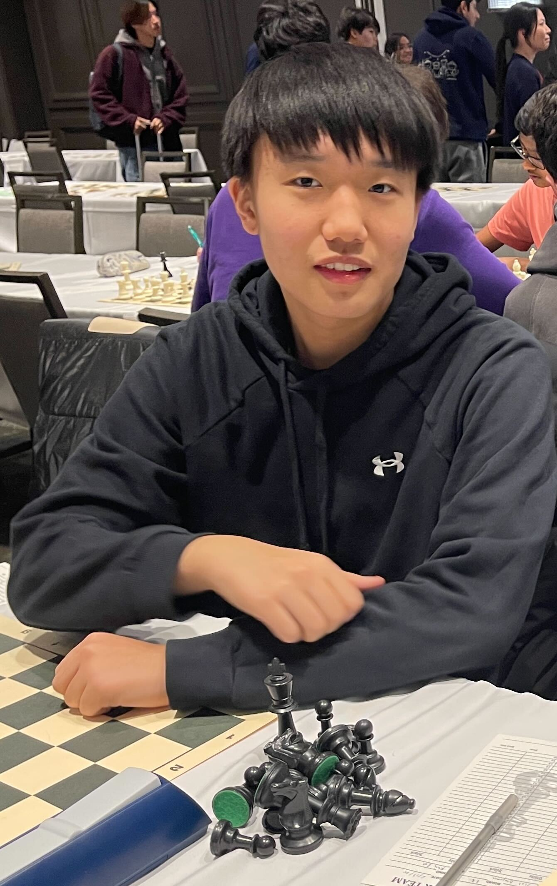
  

    
<strong>Jonathan Xu</strong> 
    Undergraduate Student, Applied Mathematics and Computer Science, Brown University (2025 – Present)

  

  
  

    
<strong>Jefferey Lee</strong> 
    Undergraduate Student, Applied Mathematics and Computer Science, Brown University (2025 – Present)

  

## Alumni

  
<strong>Jingxuan Bao</strong> 
  Postdoctoral Research Associate (2025 – 2026); now ML/AI Scientist I at the Allen Institute

  
<strong>Zizhao Xie</strong> 
  M.S. Student, Biostatistics (2025 – 2026); now PhD Student at the University of Minnesota

  
<strong>Ian Liu</strong> 
  M.S. Student, Biostatistics (2025 – 2026); now PhD Student at Dartmouth College

  
<strong>Zixiao Gao</strong> 
  M.S. Student, Computer Science (2025 - 2026); now PhD Student at Brown University

  
<strong>Wenxing (Blue) Wang</strong> 
  Visiting Research Assistant; now PhD Student in Biostatistics at the University of Florida

  
<strong>Vivek Rajani</strong> 
  Undergraduate Student Researcher (2023 - 2025); Now Clinical Research Assistant at Brigham and Women’s Hospital (BWH)

  
<strong>Faith Shim</strong> 
  Undergraduate Researcher (2024–2025); now Engineer I at Verizon

